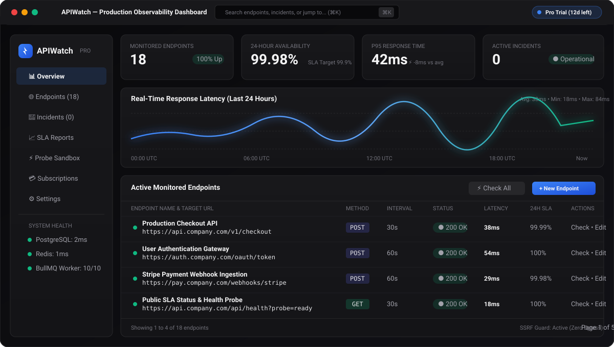
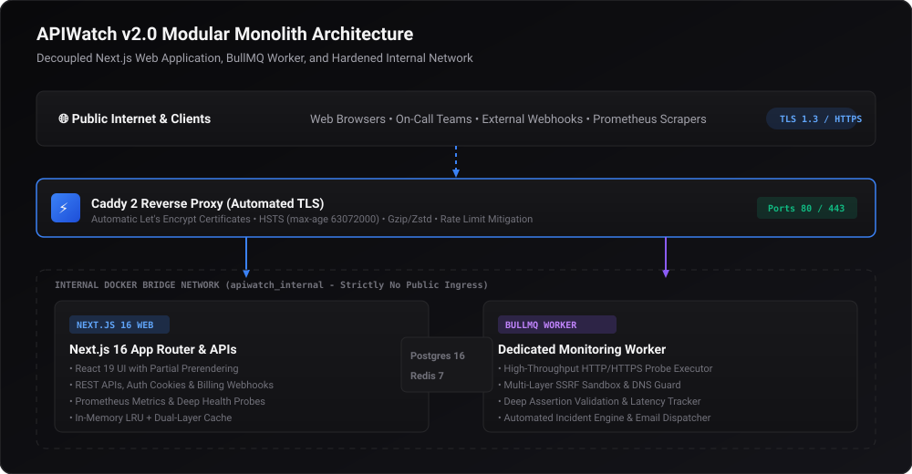
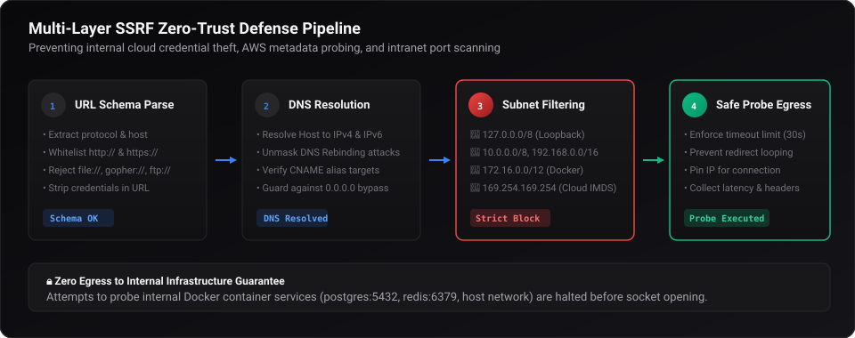
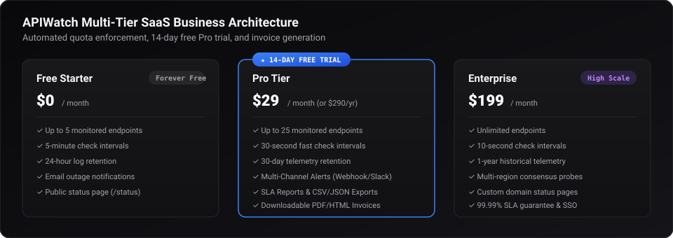

# 🛰️ APIWatch — Enterprise Real-Time API Monitoring Platform

<p align="center">
  
</p>

<p align="center">
  <a href="https://www.typescriptlang.org/"></a>
  <a href="https://nextjs.org/"></a>
  <a href="https://tailwindcss.com/"></a>
  <a href="https://www.prisma.io/"></a>
  <a href="https://bullmq.io/"></a>
  <a href="https://www.postgresql.org/"></a>
  <a href="https://redis.io/"></a>
  <a href="https://caddyserver.com/"></a>
  <a href="https://vitest.dev/"></a>
  <a href="#-arsitektur-keamanan--hardening"></a>
  <a href="./docs/API_DOCUMENTATION.md#7-system-health--observability-apis"></a>
  <a href="./src/app/pricing/page.tsx"></a>
</p>

**APIWatch** adalah platform SaaS pemantauan API (*Synthetic API Monitoring & Outage Alerting*) modern berbasis arsitektur **modular monolith** dengan background worker terpisah (*decoupled worker daemon*). Dirancang khusus untuk developer dan tim engineering dalam memantau performa, latensi respon, ketersediaan (*uptime SLA*), asersi respon mendalam (*deep assertions*), siklus insiden otomatis, serta publikasi papan status publik (*status board*) dengan keamanan multi-layer zero-trust.

---

## 📑 Daftar Isi

- [Tentang APIWatch](#-tentang-apiwatch)
- [Arsitektur Sistem](#-arsitektur-sistem)
- [Fitur Unggulan v2.0](#-fitur-unggulan-v20)
- [Arsitektur Keamanan & Zero-Trust SSRF Guard](#-arsitektur-keamanan--zero-trust-ssrf-guard)
- [Model Bisnis SaaS & Paket Berlangganan](#-model-bisnis-saas--paket-berlangganan)
- [Observabilitas & Monitoring APM](#-observabilitas--monitoring-apm)
- [Tech Stack](#-tech-stack)
- [Struktur Direktori](#-struktur-direktori)
- [Panduan Instalasi & Menjalankan Lokal](#-panduan-instalasi--menjalankan-lokal)
- [Panduan Deployment Produksi (Docker Compose)](#-panduan-deployment-produksi-docker-compose)
- [Automated Smoke Testing](#-automated-smoke-testing)
- [Referensi REST API](#-referensi-rest-api)
- [Pengujian & Verifikasi Kualitas](#-pengujian--verifikasi-kualitas)
- [Direktori Dokumentasi Lengkap](#-direktori-dokumentasi-lengkap)
- [Lisensi](#-lisensi)

---

## 💡 Tentang APIWatch

Ketergantungan terhadap integritas dan kecepatan API saat ini sangat krusial bagi aplikasi web dan mobile. Sering kali gangguan (*outage*) baru disadari setelah pelanggan menyampaikan komplain.

**APIWatch** memecahkan masalah ini secara proaktif:
1. **Automated Probing**: Menjalankan pengecekan terjadwal (mulai dari 30 detik hingga 60 menit) dengan timeout handling, custom headers, auth bearer token, dan request body.
2. **Deep Assertion Engine**: Memvalidasi status code HTTP, batas latensi toleransi (< ms), header wajib, serta pencocokan substring/JSON body.
3. **Automated Incident Lifecycle**: Membuka insiden otomatis saat terdeteksi kegagalan berturut-turut, melacak durasi downtime, dan menyebarkan email alert atau webhook instan.
4. **Public Trust**: Menyediakan halaman status publik (`/status`) independen tanpa mengharuskan pengguna login.

---

## 🏗️ Arsitektur Sistem

APIWatch dibangun dengan filosofi **Modular Monolith**: satu codebase terpadu yang memisahkan tanggung jawab web/API dengan antrean worker berat melalui antrean **BullMQ** dan **Redis 7**.

<p align="center">
  
</p>

### Komponen Utama:
- **Caddy 2 Reverse Proxy**: Mengelola terminasi TLS otomatis via Let's Encrypt, HTTP-to-HTTPS redirect, kompresi Gzip/Zstandard, dan header keamanan HSTS.
- **Next.js 16 Web Application**: Menyajikan dashboard interaktif (React 19), REST API endpoints, otentikasi HMAC stateless, dan integrasi webhook pembayaran.
- **BullMQ Dedicated Worker**: Daemon terpisah yang menjalankan pengecekan HTTP berkecepatan tinggi, sandbox SSRF, dan pengiriman alert SMTP.
- **Dual-Layer Cache**: Menggabungkan in-memory LRU cache dengan Redis 7 untuk akselerasi pembacaan ringkasan dashboard (< 5ms).
- **PostgreSQL 16**: Basis data relasional dengan indeks komposit optimal pada riwayat pengecekan dan insiden.

---

## ✨ Fitur Unggulan v2.0

- ⌨️ **Global Command Palette (`⌘K` / `Ctrl+K`)**: Akses navigasi cepat ke seluruh endpoint, pencarian instan, pintasan laporan, dan dokumentasi API.
- 📦 **Bulk Actions & Multi-Select**: Jeda (*pause*), aktifkan kembali (*resume*), atau hapus banyak endpoint sekaligus hanya dengan sekali klik.
- ⚡ **Batch Check-All**: Pemicu pengecekan diagnostik instan secara paralel untuk seluruh endpoint dalam workspace.
- 🔍 **Filtering & Multi-Column Sorting**: Urutkan endpoint berdasarkan nama, latensi p95, persentase uptime, atau status kesehatan terkini.
- 📈 **SLA Reports & CWE-1236 Safe Export**: Download laporan performa ketersediaan (24h, 7d, 30d, 90d) berformat CSV atau JSON dengan sanitasi injeksi spreadsheet otomatis.
- 🚀 **Onboarding Wizard**: Panduan langkah demi langkah untuk pengguna baru dalam mendaftarkan endpoint perdana dan menguji notifikasi webhook.
- 📢 **Public SLA Status Board (`/status`)**: Menampilkan ketersediaan layanan publik secara real-time dengan status badges dan riwayat insiden.

---

## 🔒 Arsitektur Keamanan & Zero-Trust SSRF Guard

Pengecekan API pengguna rentan disalahgunakan untuk menyerang jaringan internal (*Server-Side Request Forgery*). APIWatch menerapkan **Zero-Trust Multi-Layer SSRF Guard**:

<p align="center">
  
</p>

| Lapisan Keamanan | Implementasi Teknis | Perlindungan yang Diberikan |
| :--- | :--- | :--- |
| **SSRF DNS Interceptor** | [`src/lib/monitoring/ssrf-guard.ts`](./src/lib/monitoring/ssrf-guard.ts) | Resolusi DNS awal dan pemblokiran otomatis subnet RFC 1918, loopback (`127.0.0.1`), IPv6 loopback (`::1`), link-local AWS metadata (`169.254.169.254`), serta penolakan skema non-HTTP (`file://`, `ftp://`). |
| **Enkripsi Kredensial DB** | [`src/lib/crypto.ts`](./src/lib/crypto.ts) | Custom authorization headers, basic auth, dan token tersimpan di database menggunakan enkripsi simetris terotentikasi **AES-256-GCM**. |
| **Stateless HMAC Sessions** | [`src/lib/auth/session.ts`](./src/lib/auth/session.ts) | Cookie sesi ditandatangani dengan SHA-256 HMAC (64-char hex key) dengan flag `HttpOnly; Secure; SameSite=Lax` dan prefiks `__Host-`. |
| **Proteksi CSV Injection** | [`src/lib/csv.ts`](./src/lib/csv.ts) | Mengamankan sel CSV yang diawali karakter formula (`=`, `+`, `-`, `@`, `\t`, `\r`) dengan *single-quote escaping* (CWE-1236). |
| **Isolasi Jaringan Docker** | [`docker-compose.yml`](./docker-compose.yml) | Database PostgreSQL dan Redis terikat strictly pada internal bridge network `apiwatch_internal` tanpa ekspos port ke internet. |

---

## 💼 Model Bisnis SaaS & Paket Berlangganan

APIWatch dirancang sebagai produk SaaS siap komersialisasi dengan penegakan kuota multi-tier dan masa percobaan otomatis:

<p align="center">
  
</p>

- **Free Starter ($0/bulan)**: 5 endpoint, interval cek 5 menit, retensi log 24 jam, notifikasi email, dan status page publik.
- **Pro Tier ($29/bulan)**: **14-Day Free Pro Trial** otomatis tanpa kartu kredit, 25 endpoint, interval cek 30 detik, retensi 30 hari, alert multi-channel (Webhook/Slack), dan ekspor laporan SLA.
- **Enterprise ($199/bulan)**: Endpoint tak terbatas, interval 10 detik, retensi 1 tahun, probe konsensus multi-region, custom domain status page, dan SLA 99.99%.
- **Billing Engine**: Checkout simulator / gateway integration, faktur PDF/HTML yang dapat diunduh, serta webhook lifecycle processor (`invoice.payment_succeeded`, `subscription.updated`).

---

## 📊 Observabilitas & Monitoring APM

APIWatch v2.0 dilengkapi infrastruktur telemetri mendalam:

- **Prometheus Telemetry (`/api/metrics`)**: Mengekspos metrik `http_requests_total`, latensi kuantil p50/p95/p99, database query latency, penggunaan memori RSS, dan CPU time untuk scraper Prometheus/Grafana.
- **Deep Readiness Probes (`/api/health?probe=ready`)**: Pengecekan aktif kesehatan konektivitas dan latensi terhadap PostgreSQL dan Redis.
- **Structured JSON Logging**: Format log standar produksi dengan sanitasi otomatis data pribadi (PII redaction) terhadap token, password, dan header otorisasi.
- **Runtime Error Tracker**: Pelacakan pengecualian dengan fingerprinting unik dan breadcrumb memori untuk diagnosis cepat tanpa mengorbankan privasi pengguna.

---

## 🛠️ Tech Stack

### Frontend & UI
- **Framework**: Next.js 16 (Turbopack, App Router, Partial Prerendering)
- **UI Library**: React 19, Tailwind CSS v4, shadcn/ui
- **Icons & Charts**: Lucide React & Recharts
- **State & Notifications**: Sonner, Radix UI Primitives

### Backend & Engine
- **Runtime**: Node.js 20+ LTS / TypeScript 5.x
- **ORM & Database**: Prisma ORM 6.19 & PostgreSQL 16 Alpine
- **Queue & Scheduler**: BullMQ 6.7 & Redis 7 Alpine
- **Email Delivery**: Nodemailer (SMTP / Transactional Provider)

### DevOps & Infrastruktur
- **Containerization**: Docker Engine & Docker Compose (Multi-stage Alpine)
- **Reverse Proxy**: Caddy 2 (Automatic TLS Let's Encrypt & HSTS)
- **Testing Framework**: Vitest (134 automated unit, integration, api, and e2e tests)

---

## 📂 Struktur Direktori

```
apiwatch/
├── docs/                        # Dokumentasi teknis & operasional
│   ├── API_DOCUMENTATION.md     # Spesifikasi lengkap REST API
│   ├── PRODUCTION_CHECKLIST.md  # Checklist pre-flight & verification matrix
│   ├── DATABASE_MIGRATION_GUIDE.md # Panduan migrasi database zero-downtime
│   ├── ENVIRONMENT_CONFIGURATION.md # Referensi environment variables
│   ├── ROLLBACK_STRATEGY.md     # Prosedur emergency rollback playbooks
│   ├── POST_LAUNCH_MONITORING.md # SLI/SLO & Prometheus alerting rules
│   └── PRODUCT_ROADMAP.md       # Roadmap pengembangan fitur masa depan
├── prisma/
│   ├── schema.prisma            # Skema Prisma dengan indeks performa
│   └── migrations/              # Riwayat migrasi SQL
├── public/
│   └── docs/                    # Diagram arsitektur & preview dashboard SVG
├── scripts/
│   ├── backup.sh                # Skrip backup database PostgreSQL harian
│   ├── restore.sh               # Skrip pemulihan database
│   ├── backup-db.sh             # Skrip backup mandiri dengan SHA-256 checksum
│   ├── smoke-test.mjs           # Smoke test runner multi-platform (Node.js)
│   └── smoke-test.sh            # Smoke test runner bash/cURL
├── src/
│   ├── app/                     # Next.js App Router (43 routes)
│   │   ├── (auth)/              # Halaman Login & Registrasi
│   │   ├── (dashboard)/         # Workspace: Dashboard, Endpoints, Incidents, Reports, Settings
│   │   ├── api/                 # REST API Handlers (Endpoints, Billing, Health, Metrics, dll)
│   │   ├── pricing/             # Halaman publik Pricing & Plans
│   │   ├── status/              # Public Status Board
│   │   ├── opengraph-image.tsx  # Dynamic Open Graph banner generator
│   │   ├── robots.ts            # Robots.txt directives
│   │   └── sitemap.ts           # Dynamic XML Sitemap
│   ├── components/              # Komponen UI React 19
│   └── lib/                     # Core logic, security, caching, observability, services
├── worker/
│   └── src/index.ts             # Dedicated background probe worker daemon
├── docker-compose.yml           # Orkestrasi 5 container produksi
├── Dockerfile                   # Multi-stage Dockerfile Next.js standalone
├── Dockerfile.worker            # Dockerfile background worker
└── Caddyfile                    # Konfigurasi reverse proxy & HTTPS
```

---

## 💻 Panduan Instalasi & Menjalankan Lokal

### Prasyarat Sistem
- **Node.js**: >= 20.0.0 LTS (Rekomendasi: Node.js 22 LTS)
- **pnpm**: >= 9.0.0 (Rekomendasi: pnpm 10+)
- **PostgreSQL**: 15 atau 16
- **Redis**: 7+

### Langkah-Langkah

1. **Clone Repository**:
   ```bash
   git clone https://github.com/your-org/apiwatch.git
   cd apiwatch
   ```

2. **Install Dependensi**:
   ```bash
   pnpm install
   ```

3. **Konfigurasi Environment Variable**:
   ```bash
   cp .env.example .env.local
   ```
   Pastikan variabel `DATABASE_URL`, `REDIS_URL`, `AUTH_SECRET`, dan `ENCRYPTION_KEY` terkonfigurasi.

4. **Inisialisasi Database**:
   ```bash
   pnpm prisma generate
   pnpm prisma migrate dev
   ```

5. **Jalankan Aplikasi Web**:
   ```bash
   pnpm dev
   ```
   Akses aplikasi di browser pada [http://localhost:3000](http://localhost:3000).

6. **Jalankan Background Worker** *(di terminal terpisah)*:
   ```bash
   pnpm worker
   ```

---

## 🐳 Panduan Deployment Produksi (Docker Compose)

APIWatch telah dilengkapi konfigurasi Docker Compose siap pakai untuk server Ubuntu VPS:

```bash
# 1. Masuk ke VPS dan clone repository
git clone https://github.com/your-org/apiwatch.git /opt/apiwatch
cd /opt/apiwatch

# 2. Siapkan file konfigurasi produksi
cp .env.production.example .env
nano .env

# 3. Generate rahasia kriptografi 64-karakter hex
openssl rand -hex 32 # untuk AUTH_SECRET
openssl rand -hex 32 # untuk ENCRYPTION_KEY
openssl rand -hex 24 # untuk POSTGRES_PASSWORD & REDIS_PASSWORD

# 4. Bangun dan jalankan stack produksi
docker compose up -d --build

# 5. Verifikasi status container
docker compose ps
```

---

## 🧪 Automated Smoke Testing

Jalankan pengujian smoke test otomatis pasca deployment:

```bash
# Menggunakan Node.js runner (Multi-platform):
node scripts/smoke-test.mjs https://apiwatch.example.com

# Atau menggunakan Bash/cURL script:
chmod +x scripts/smoke-test.sh
./scripts/smoke-test.sh https://apiwatch.example.com
```

Pengujian ini memverifikasi secara end-to-end:
- Liveness & Readiness health probe
- Prometheus metrics exposition
- Halaman landing, pricing, status, login, dan register
- Robots.txt, sitemap XML, dan Open Graph social image

---

## 📡 Referensi REST API

| Method | Endpoint | Deskripsi | Akses |
| :--- | :--- | :--- | :--- |
| `GET` | `/api/health` | Liveness & Readiness health probe (DB & Redis) | Publik |
| `GET` | `/api/metrics` | Telemetri Prometheus APM | Ops / Scraper |
| `POST` | `/api/auth/register` | Pendaftaran akun dan inisialisasi trial 14 hari | Publik |
| `POST` | `/api/auth/login` | Login dan penerbitan cookie sesi HMAC | Publik |
| `GET` | `/api/auth/me` | Sesi dan profil pengguna aktif | Sesi |
| `POST` | `/api/auth/logout` | Pembersihan cookie sesi | Sesi |
| `GET` | `/api/endpoints` | Daftar endpoint (pencarian, pagination, filter) | Sesi |
| `POST` | `/api/endpoints` | Registrasi endpoint baru dengan validasi SSRF | Sesi |
| `GET` | `/api/endpoints/[id]` | Detail konfigurasi endpoint spesifik | Sesi |
| `PATCH` | `/api/endpoints/[id]` | Pembaruan konfigurasi monitoring | Sesi |
| `DELETE`| `/api/endpoints/[id]` | Penghapusan endpoint dan riwayat cek | Sesi |
| `POST` | `/api/endpoints/[id]/check` | Pemicu pengecekan diagnostik instan | Sesi |
| `POST` | `/api/endpoints/[id]/clone` | Kloning konfigurasi endpoint | Sesi |
| `POST` | `/api/endpoints/bulk` | Tindakan massal (pause, resume, delete) | Sesi |
| `POST` | `/api/endpoints/check-all` | Pengecekan paralel seluruh endpoint workspace | Sesi |
| `GET` | `/api/incidents` | Riwayat dan status siklus insiden | Sesi |
| `GET` | `/api/reports` | Ringkasan SLA ketersediaan (24h, 7d, 30d, 90d) | Sesi |
| `GET` | `/api/reports/export` | Download laporan format CSV atau JSON | Sesi |
| `GET` | `/api/billing/subscription` | Informasi paket, limit kuota, dan masa trial | Sesi |
| `POST` | `/api/billing/checkout` | Permintaan checkout upgrade paket | Sesi |
| `GET` | `/api/billing/invoices` | Riwayat faktur dan pembayaran | Sesi |
| `POST` | `/api/billing/webhook` | Ingestion webhook event pembayaran (HMAC) | Gateway |

*Spesifikasi lengkap dengan contoh payload request/response tersedia di [`docs/API_DOCUMENTATION.md`](./docs/API_DOCUMENTATION.md).*

---

## 🧪 Pengujian & Verifikasi Kualitas

Kualitas kode dan keandalan sistem telah diaudit secara menyeluruh:

```bash
# Menjalankan 134 Automated Tests (Unit, Integration, E2E, UI, RBAC)
pnpm test

# Menjalankan verifikasi tipe TypeScript
pnpm exec tsc --noEmit

# Menjalankan linter kode ESLint
pnpm lint

# Audit dependensi keamanan produksi
pnpm audit --prod

# Uji kompilasi build produksi Next.js
pnpm build
```

### Hasil Audit Terakhir:
- **Automated Tests**: **134/134 lulus (100% pass rate)** dalam 1.41s.
- **Audit Keamanan**: **0 kerentanan (0 vulnerabilities)** pada `pnpm audit --prod`.
- **Static Analysis**: **0 TypeScript errors & 0 ESLint warnings**.
- **Observability**: Prometheus metrics `/api/metrics`, deep health checks `/api/health?probe=ready`, structured JSON logger with PII redaction.
- **SaaS Business**: Multi-tier quotas (Free, Pro, Enterprise), 14-day Pro trial, webhook billing processor.
- **Build Output**: 43 routes terkompilasi sukses dengan Next.js standalone runner bundle.

---

## 📚 Direktori Dokumentasi Lengkap

Dokumentasi teknis komprehensif tersedia pada direktori [`docs/`](./docs/):
- 📖 [`docs/API_DOCUMENTATION.md`](./docs/API_DOCUMENTATION.md) — Panduan integrasi REST API lengkap.
- 🚀 [`docs/PRODUCTION_CHECKLIST.md`](./docs/PRODUCTION_CHECKLIST.md) — Pre-flight checklist & verification matrix.
- 🗄️ [`docs/DATABASE_MIGRATION_GUIDE.md`](./docs/DATABASE_MIGRATION_GUIDE.md) — Prosedur migrasi database zero-downtime & index optimization.
- ⚙️ [`docs/ENVIRONMENT_CONFIGURATION.md`](./docs/ENVIRONMENT_CONFIGURATION.md) — Panduan variabel lingkungan dan rahasia enkripsi.
- 🔄 [`docs/ROLLBACK_STRATEGY.md`](./docs/ROLLBACK_STRATEGY.md) — SOP emergency rollback & disaster recovery.
- 📊 [`docs/POST_LAUNCH_MONITORING.md`](./docs/POST_LAUNCH_MONITORING.md) — Runbook observabilitas paska rilis & alert rules.
- 🗺️ [`docs/PRODUCT_ROADMAP.md`](./docs/PRODUCT_ROADMAP.md) — Roadmap pengembangan jangka panjang (Fase 11–16).
- 🚢 [`DEPLOYMENT_GUIDE.md`](./DEPLOYMENT_GUIDE.md) — Panduan deployment server Ubuntu dengan Caddy TLS & Docker Compose.
- 📢 [`RELEASE_NOTES.md`](./RELEASE_NOTES.md) — Catatan rilis resmi v2.0.0 Production LTS.

---

## 📄 Lisensi

Proyek ini dikembangkan secara proprietary dan privat untuk **APIWatch Platform**.  
Seluruh hak cipta dilindungi undang-undang © 2026 APIWatch Inc.
